  

  
  
  <!-- Portfolio button: replace PORTFOLIO_URL with your portfolio address, then remove the comment markers around this line.
  
  -->

  
  
  
  
  
  

  <a href="#how-the-systems-fit-together">Architecture</a> ·
  <a href="#featured-systems">Featured systems</a> ·
  <a href="#more-projects">More projects</a> ·
  <a href="#toolkit">Toolkit</a> ·
  <a href="#experience">Experience</a> ·
  <a href="#credentials">Credentials</a>

## About

I'm a Computer Science and Engineering student at **Lovely Professional University**, focused on **applied AI, data engineering, and analytics**. I build end-to-end projects that turn raw data into useful tools—from ingestion and analysis to retrieval or machine learning, APIs, and user interfaces. My work includes healthcare access analytics, legal document retrieval, market-news analysis, and explainable NLP. I work mainly with Python and SQL, alongside FastAPI, PyTorch, scikit-learn, React, and Streamlit.

  

## How the systems fit together

  

## Featured systems

Six projects that show how I work across data, applied AI, analytics, and software.

### [Rural Healthcare Access Gap Mapper](https://github.com/Har-dik25/Rural-Healthcare-Access-Gap)

- Combines MoHFW, Census, NFHS-5, and travel-time data for **640 districts and 673,638 villages** in a SQLite analytical warehouse.
- Adds a composite Access Gap Index and a 12-module Streamlit dashboard with GIS maps, district drill-downs, and resource-allocation what-if analysis.
- **Status:** Decision-support prototype using public data; runs locally with documented tests.

### [Samvidhan AI (LegalMind)](https://github.com/Har-dik25/Samvidhan_AI)

- Implements hybrid retrieval over **3,840+ legal chunks**, combining ChromaDB dense search, BM25, reciprocal-rank fusion, and cross-encoder reranking.
- Returns extractive statutory passages and IPC/CrPC-to-BNS/BNSS mappings through a React and FastAPI workspace with streamed responses.
- **Status:** Full-stack legal research prototype; not legal advice.

### [Algorithmic Market Sentiment and News Vector Correlation Platform](https://github.com/Har-dik25/Algorithmic-Market-Sentiment-News-Vector-Correlation-Platform)

- Ingests financial news, SEC filings, FNSPID data, and NSE feeds; cleans and indexes text in Qdrant for semantic search.
- Tests news-sentiment signals against returns with lead-lag correlation and p-values, with a HistGradientBoosting model for comparison.
- **Status:** End-to-end exploratory research pipeline; not a trading system.

### [TransitAI: Public Transport Delay Analyzer](https://github.com/Har-dik25/Public-Transport-Delays-with-Weather-Events)

- Uses a `make`-driven pipeline to join **simulated NYC MTA bus trips** with historical weather and city events, then trains delay models with SHAP explanations.
- **Status:** Local analytics prototype; simulated trip records demonstrate the approach, not real MTA performance.

### [ShopWave: Autonomous Support Resolution Agent](https://github.com/Har-dik25/ShopWave_Autonomous_Support_Resolution_Agent)

- A deterministic Python agent classifies support tickets and routes them through policy-gated tools, with refund checks, retries, human escalation, and audit logging.
- **Status:** Standard-library prototype tested on synthetic tickets; no LLM calls.

### [TruthLens AI: Fake News Detection](https://github.com/Har-dik25/Fake-News-Detection-System)

- Trains BERT and BiLSTM-attention models on **72,134 WELFake articles**, with NLP features and word-level attention visualizations.
- Serves predictions through FastAPI and an explainability-focused browser interface.
- **Status:** Training and serving pipeline with model-comparison and error-analysis tooling.

## More projects

| Project | What it is | Stack | Status |
|---|---|---|---|
| [CampusFlow: University Management System](https://github.com/Har-dik25/UMS-replica) | FastAPI and React application covering student and faculty records, academics, attendance, exams, fees and library operations. |    | Full-stack application |
| [EcoEats: Food Waste Website](https://github.com/Har-dik25/Food-Wastage-website) | Responsive front end for coordinating surplus-food donations. |    | Front-end concept |
| [Perfect Present: Gift Recommendation Website](https://github.com/Har-dik25/Personalized-Gift-recommendation-) | Front end for exploring gift ideas by recipient and occasion. |    | Front end |
| [HitCast: Spotify Popularity Predictor](https://github.com/Har-dik25/HitCast-Spotify-Track-Popularity-Predictor) | Machine-learning project to estimate track popularity from audio features. | Not yet documented | In progress |
| [AI-Powered Traffic Congestion Analysis](https://github.com/Har-dik25/AI-Traffic-Congestion-Analysis) | Team project exploring historical traffic data, congestion prediction, and local dashboard visualizations. | Python, pandas, scikit-learn, Flask | Analytics project |
| [OCR Studio: Offline Image-to-JSON](https://github.com/Har-dik25/OCR-Studio-Offline-Image-to-JSON-Web-App) | Offline-first Flask utility that extracts image text and exports structured JSON. | Python, Flask, OpenCV, Tesseract | Local web utility |
| Nexus HR Core ([frontend](https://github.com/Har-dik25/hrms-frontend), [backend](https://github.com/Har-dik25/hrms-backend)) | Role-based employee, attendance, and leave management application. | FastAPI, PostgreSQL, React | Full-stack application |

## Toolkit

Core areas: Python and SQL; data analysis and visualization; machine learning and NLP; retrieval and vector search; APIs and web applications; Docker, CI, and testing.

  

## Experience

  

**Applied AI & Intelligent Systems Intern — Futurense Technologies (Jun–Jul 2026):** Prototyped AI/ML pipelines spanning data ingestion, preprocessing, inference, and API serving, using prompt engineering and embeddings.

**Data Intern — Futurense Technologies (Jun–Aug 2025):** Built lead-volume and conversion forecasts, cleaned marketing data, and created Power BI funnel and cohort dashboards that identified **15% critical inefficiencies** in CPL-focused optimization.

  <a href="https://www.linkedin.com/posts/hardik8_internship-activity-7429402370805047296-5OnB">Data internship post</a> ·
  <a href="https://lnkd.in/p/dCbWkd-U">Applied AI internship certificate</a>

## Credentials

| Credential | Issuer | Link |
|---|---|---|
| Oracle Cloud Infrastructure 2025 Certified Generative AI Professional | Oracle University | [LinkedIn post](https://www.linkedin.com/posts/hardik8_generative-ai-professional-activity-7388917134468431872-ipzL) |
| Oracle Cloud Infrastructure 2025 Certified Data Science Professional | Oracle University | [LinkedIn post](https://www.linkedin.com/posts/hardik8_data-science-professional-activity-7389534104666476544-doIF) |
| SQL (Advanced) |  HackerRank | [Profile](https://www.hackerrank.com/profile/hardikkumar2583) |
| CSS (Basic) |  HackerRank | [Profile](https://www.hackerrank.com/profile/hardikkumar2583) |
| Build Generative AI Apps and Solutions with No-Code Tools |  Udemy | Course completion |

Also: 5-star HackerRank rating in Python and SQL (Oct 2025), and participant in the Google Gen AI Exchange Hackathon and Smart India Hackathon (2025).

