  

  <a href="https://github.com/Har-dik25?tab=repositories">REPOSITORIES</a> ·
  <a href="https://www.linkedin.com/in/hardik8/">LINKEDIN</a> ·
  <a href="mailto:hardikkumar2583@gmail.com">EMAIL</a> ·
  <a href="https://www.kaggle.com/choudhary25">KAGGLE</a> ·
  <a href="https://leetcode.com/u/Choudhary_25/">LEETCODE</a> ·
  <a href="https://www.hackerrank.com/profile/hardikkumar2583">HACKERRANK</a>

  <a href="#featured-systems">FEATURED SYSTEMS</a> ·
  <a href="#more-projects">MORE PROJECTS</a> ·
  <a href="#technical-toolkit">TOOLKIT</a> ·
  <a href="#experience">EXPERIENCE</a> ·
  <a href="#certifications">CERTIFICATIONS</a>

## The engineering lane

I’m a B.Tech Computer Science student at **Lovely Professional University**, specializing in **Artificial Intelligence and Data Engineering**. I build systems that connect the full path from messy source data to useful outcomes: data preparation and analytical models, retrieval-grounded AI, tool-driven agents, APIs, and decision-support interfaces.

My work sits at the intersection of **data engineering, data science, analytics, applied ML, generative AI, and agentic application development**. I focus on the parts that make a prototype useful: trustworthy inputs, an explainable method, traceable outputs, and an interface people can act on.

  

## What I build

| Discipline | What that looks like in my projects |
|---|---|
| **Data engineering** | Ingestion and transformation workflows, integrated datasets, SQL-backed analytical stores, repeatable processing, and validation checks. |
| **Data science & analytics** | Exploratory analysis, feature design, statistical relationships, predictive modelling, explainability, geospatial analysis, and scenario testing. |
| **Applied AI & GenAI** | Embeddings, hybrid retrieval, semantic search, reranking, NLP classification, and grounded answers for domain-specific workflows. |
| **Agentic systems & AI products** | Tool orchestration, multi-step resolution, policy checks, escalation paths, audit logs, API services, and usable front ends. |

## Featured systems

### 1. [Rural Healthcare Access Gap Mapper](https://github.com/Har-dik25/Rural-Healthcare-Access-Gap)

A national-scale decision-support project combining public-health, census, and NFHS-5 data to identify where rural healthcare access is weakest—and whether the gap is driven by staffing, facility capacity, quality, or travel friction. Its composite Access Gap Index sits on top of a SQLite analytical warehouse, while an interactive Streamlit/GIS dashboard supports district ranking and resource-allocation scenarios. The repository documents coverage of **640 districts and 673,638 villages**.

### 2. [Samvidhan AI — Legal Intelligence](https://github.com/Har-dik25/Samvidhan_AI)

A retrieval-first research workspace for Indian statutory material and legal precedents. It combines dense semantic retrieval with BM25 keyword search, rank fusion, and cross-encoder reranking to return structured, source-grounded legal information rather than relying on unconstrained free-form generation. The project README documents a corpus of **3,840+ statutory and precedent chunks**.

### 3. [Market Sentiment & News Vector Correlation Platform](https://github.com/Har-dik25/Algorithmic-Market-Sentiment-News-Vector-Correlation-Platform)

An end-to-end financial data system that ingests market news, turns articles into 384-dimensional semantic vectors, indexes them in Qdrant, and tests lead/lag relationships between news-derived signals and price movement across a configurable trading window. The project documents coverage of **25+ tickers** and sub-300 ms p95 semantic-search latency. A FastAPI service and Next.js console connect retrieval, correlation analysis, and model outputs in one workflow.

### 4. [TransitAI — Public Transport Delay Analyzer](https://github.com/Har-dik25/Public-Transport-Delays-with-Weather-Events)

A predictive analytics pipeline using **simulated NYC MTA trip records**, enriched with historical weather and major city events. Random Forest and Gradient Boosting models estimate delay outcomes, while a Streamlit dashboard supports exploration and what-if scenarios; SHAP is used to inspect which conditions influence predictions.

### 5. [ShopWave — Autonomous Support Resolution Agent](https://github.com/Har-dik25/ShopWave_Autonomous_Support_Resolution_Agent)

A deliberately auditable support agent that classifies incoming e-commerce tickets, uses a 9-tool toolkit to verify and carry out multi-step policy-based actions, and escalates uncertain cases to a human with context. Its documented implementation processes a 20-ticket test workload and records decisions in an audit trail. It uses deterministic Python rules rather than calling an LLM API, making reliability and controlled automation explicit design choices.

  

### 6. [AI-Powered Traffic Congestion Analysis](https://github.com/Har-dik25/AI-Traffic-Congestion-Analysis)

A traffic analytics application built around historical congestion data and reports from sources such as TOMTOM and INRIX. The workflow covers data cleanup, pattern analysis, machine-learning-based congestion prediction, AWS Lambda deployment, and a Flask dashboard for heatmaps and travel insights.

## More projects

| Project | Engineering focus |
|---|---|
| [OCR Studio — Offline Image-to-JSON](https://github.com/Har-dik25/OCR-Studio-Offline-Image-to-JSON-Web-App) | An offline-first Flask application that processes uploaded images with OpenCV and Tesseract, displays extracted text, and exports structured JSON. |
| [TruthLens AI — Fake News Detection](https://github.com/Har-dik25/Fake-News-Detection-System) | A credibility-analysis pipeline combining BERT with BiLSTM + self-attention and classical text signals (TF-IDF, POS features, VADER sentiment). Its FastAPI service exposes predictions and token-level explanations; the documented WELFake dataset contains 72,134 articles. |
| [Nexus HR Core — Frontend](https://github.com/Har-dik25/hrms-frontend) · [Backend](https://github.com/Har-dik25/hrms-backend) | HR workflow product with separate frontend/backend repositories; the frontend README documents role-specific Admin and Employee dashboards, attendance and leave charts, React, Vite, Tailwind CSS, and Docker/Nginx deployment. |
| [CampusFlow — University Management System](https://github.com/Har-dik25/UMS-replica) | Full-stack university workflow system built with FastAPI and React, covering student/faculty records, academics, attendance, exams, fees, and library operations. |
| [HitCast — Spotify Popularity Predictor](https://github.com/Har-dik25/HitCast-Spotify-Track-Popularity-Predictor) | A work in progress; the repository is currently marked “In Progress.” |

## Technical toolkit

| Layer | Tools and methods |
|---|---|
| **Languages & query** | Python, SQL, Java, JavaScript, HTML, CSS |
| **Data & analytics** | Pandas, NumPy, SQLite, MySQL, data cleaning, EDA, statistical analysis, feature engineering |
| **ML & NLP** | scikit-learn, PyTorch, transformers, classification/regression, model evaluation, SHAP, embeddings |
| **Retrieval & agents** | ChromaDB, Qdrant, BM25, reciprocal rank fusion, cross-encoder reranking, tool-based workflows |
| **Application layer** | FastAPI, Flask, Streamlit, React, Next.js, REST APIs |
| **Engineering & cloud** | Git, GitHub Actions, Docker, AWS EC2, S3, Lambda, testing, structured logs |

## Experience

**Applied AI & Intelligent Systems Intern — Futurense Technologies** · Jun–Jul 2026  
Worked with applied AI/ML workflows, including data preparation, prompt design, embeddings, and AI pipeline prototyping.  
[Applied AI internship completion post & certificate image](https://lnkd.in/p/dCbWkd-U)

**Data Intern — Futurense Technologies** · Jun–Aug 2025  
Worked on data preparation, analysis, and reporting workflows as part of a data internship.  
[Internship post](https://www.linkedin.com/posts/hardik8_internship-ugcPost-7429402369811189760-l06H)

## Certifications

- [Oracle Cloud Infrastructure — Generative AI Professional](https://www.linkedin.com/posts/hardik8_generative-ai-professional-ugcPost-7388917133335879680-tR8l/)
- [Oracle Cloud Infrastructure — Data Science Professional](https://www.linkedin.com/posts/hardik8_data-science-professional-ugcPost-7389534103588659200-GkAy/)

